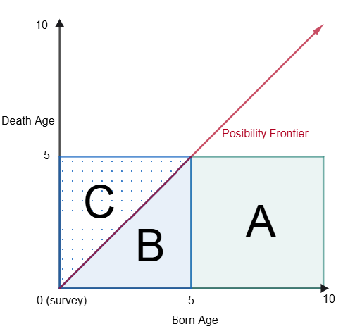

```{css, echo=FALSE}
p {
  text-align: justify !important
}
```

```{r libraries, message=FALSE, warning=FALSE, echo=FALSE}
library(tidyverse)
library(rio)
library(haven)
library(knitr)
library(DT)
library(huxtable)
library(lmtest)
library(sandwich)
library(here)
library(dplyr)
library(broom)
library(gridExtra)
library(ggridges)
library(ggplot2)
```

```{r import_data, message=FALSE, warning=FALSE, echo=FALSE}
# Load data civ88-08_nutri.dta and civ88-08_mortality.dta
civ_nutri <- read_dta(here::here("measurement_p2/data/civ88-08_nutri.dta"))
civ_mortality <- read_dta(here::here("measurement_p2/data/civ88_mort.dta"))
# save as csv
# write_csv(civ_nutri, "measurement_p2/data/civ88-08_nutri.csv")
# write_csv(civ_mortality, "measurement_p2/data/civ88-08_mortality.csv")
```

# 1 Child Mortality in Côte d'Ivoire
\textbf{1.a} I can use the pweight column to balance the class distribution of the sample to match the population distribution. The `pweight` column contains sample weights that modify the contribution of each observation to the overall statistics. It works as a frequency multiplier, where each observation is counted as if it were `pweight` number of observations. In practice, R can use the pweight column to compute weighted statistics, such as means and proportions by using the `weights` argument in functions like `lm()` or `survey::svydesign()`. Internally, weighted functions such as weighted means and lm will multiply each observation by its corresponding weight. For example a weighted mean will be computed using equation @eq-weighted_mean, and weighted linear regression will minimize the weighted sum of squared residuals, as shown in equation @eq-weighted_lm.

$$
\bar{x}_w = \frac{\sum_{i=1}^{n} w_i x_i}{\sum_{i=1}^{n} w_i}
$$ {#eq-weighted_mean}

$$
\sum_{i=1}^{n} w_i (y_i - \hat{y}_i)^2
$$ {#eq-weighted_lm}

\textbf{1.2.a} The preferable method is method 2 (M2) because method 1 (M1) underestimates the mortality rate by not capturing the deaths that occur after the survey period. @fig-mortality shows graphically the surveyed groups: the x-axis represents the age of the child at the time of the survey, and the y-axis represents the age of the child at the time of death. The red arrow at 45 degrees indicates the frontier of possible outcomes, since by definition no one can die after their current age, the survey captures outcomes below the frontier. Notice M1 captures area B and drops area C underestimating the true mortality rate. M2 captures area C which represents the true mortality rate. For example a surveyed mother has a child one year before the survey and the child dies the year after the survey (area C in @fig-mortality), M1 will not capture his death because by definition nothing can die after its current age.

M1

- Pros: it is easy to compute, captures the most recent deaths (recency).
- Cons: underestimates the mortality rate, downward biased, does not capture deaths after the survey period.

M2

- Pros: provides a robust estimate of the true mortality rate.
- Cons: it requires a longer period of time to capture deaths, less recent than M1.

{#fig-mortality width="40%"}

\textbf{1.2.b.i} I estimated the mortality rates for boys and girls using both methods in R using the columns `_l5` for method 1 and the difference of total minus `_l5` for method 2 (See appendix for code). The estimated mortality rates for boys and girls using both methods are shown in Table \ref{tbl-child_mortality}.

```{r, echo=FALSE, message=FALSE, warning=FALSE}
# Method 1
# Boys
model_1_boys <- lm(
  (dboys_l5) / (boys_l5) ~ 1, 
  data = civ_mortality %>% filter(boys_l5 > 0), 
  weights = pweight * boys_l5
)

# Girls
model_1_girls <- lm(
  (dgirls_l5) / (girls_l5) ~ 1, 
  data = civ_mortality %>% filter(girls_l5 > 0), 
  weights = pweight * girls_l5
)

# Method 2
# Boys
model_2_boys <- lm(
  (dboys_u5 - dboys_l5) / (boys - boys_l5) ~ 1, 
  data = civ_mortality %>% filter((boys - boys_l5) > 0), 
  weights = pweight * (boys - boys_l5)
)

# Girls
model_2_girls <- lm(
  (dgirls_u5 - dgirls_l5) / (girls - girls_l5) ~ 1, 
  data = civ_mortality %>% filter((girls - girls_l5) > 0), 
  weights = pweight * (girls - girls_l5)
)

# 1. Create Pooled Data for Boys
boys_pooled <- bind_rows(
  civ_mortality %>% 
    filter(boys_l5 > 0) %>% 
    transmute(rate = dboys_l5 / boys_l5, w = pweight * boys_l5, is_m2 = 0),
  civ_mortality %>% 
    filter((boys - boys_l5) > 0) %>% 
    transmute(rate = (dboys_u5 - dboys_l5) / (boys - boys_l5), w = pweight * (boys - boys_l5), is_m2 = 1)
)

# 2. Create Pooled Data for Girls
girls_pooled <- bind_rows(
  civ_mortality %>% 
    filter(girls_l5 > 0) %>% 
    transmute(rate = dgirls_l5 / girls_l5, w = pweight * girls_l5, is_m2 = 0),
  civ_mortality %>% 
    filter((girls - girls_l5) > 0) %>% 
    transmute(rate = (dgirls_u5 - dgirls_l5) / (girls - girls_l5), w = pweight * (girls - girls_l5), is_m2 = 1)
)

# 3. Run the Difference Regressions
diff_boys <- lm(rate ~ is_m2, data = boys_pooled, weights = w)
diff_girls <- lm(rate ~ is_m2, data = girls_pooled, weights = w)

# 4. Extract the coefficient matrices
ct_boys <- coeftest(diff_boys)
ct_girls <- coeftest(diff_girls)

# 5. Isolate ONLY the 2nd row (the difference), and restore the 'coeftest' class
# so that broom/huxtable knows how to read it without throwing a matrix error.
ct_diff_boys <- ct_boys[2, , drop = FALSE]
class(ct_diff_boys) <- "coeftest"
rownames(ct_diff_boys) <- "(Intercept)"  # Disguise it for alignment

ct_diff_girls <- ct_girls[2, , drop = FALSE]
class(ct_diff_girls) <- "coeftest"
rownames(ct_diff_girls) <- "(Intercept)"

# 1. Create Pooled Data for Sex Comparison (Method 2 Only)
m2_sex_pooled <- bind_rows(
  # Boys Method 2 (Indicator = 0)
  civ_mortality %>% 
    filter((boys - boys_l5) > 0) %>% 
    transmute(rate = (dboys_u5 - dboys_l5) / (boys - boys_l5), w = pweight * (boys - boys_l5), is_girl = 0),
  # Girls Method 2 (Indicator = 1)
  civ_mortality %>% 
    filter((girls - girls_l5) > 0) %>% 
    transmute(rate = (dgirls_u5 - dgirls_l5) / (girls - girls_l5), w = pweight * (girls - girls_l5), is_girl = 1)
)

# 2. Run the Difference Regression (Girls M2 - Boys M2)
diff_sex_m2 <- lm(rate ~ is_girl, data = m2_sex_pooled, weights = w)

# 3. Isolate the gender difference coefficient and disguise it for huxreg alignment
ct_diff_sex_m2 <- coeftest(diff_sex_m2)[2, , drop = FALSE]
class(ct_diff_sex_m2) <- "coeftest"
rownames(ct_diff_sex_m2) <- "(Intercept)"

# 6. Generate the single-row 6-Column Table
outreg <- huxreg(
  `M1 (Boys)` = model_1_boys,
  `M2 (Boys)` = model_2_boys,
  `Diff (Boys)` = ct_diff_boys,
  `M1 (Girls)` = model_1_girls,
  `M2 (Girls)` = model_2_girls,
  `Diff (Girls)` = ct_diff_girls,
  `Diff M2 G-B` = ct_diff_sex_m2, # New column added here
  coefs = c("Mortality rate" = "(Intercept)"),
  error_format = "({std.error})",
  error_pos = "below",
  align = "c",
  statistics = c(N = "nobs", R2 = "r.squared"),
  stars = c(`***` = 0.01, `**` = 0.05, `*` = 0.1),
  note = "Significance: {stars}"
)

outreg <- set_label(outreg, "tbl-child_mortality")
outreg <- set_caption(outreg, "Child mortality rates in Côte d'Ivoire, by sex and method.")
outreg <- set_all_padding(outreg, 1.5)
outreg
```

\textbf{1.2.b.ii} Table \ref{tbl-child_mortality} shows the estimated child mortality rates in Côte d'Ivoire for boys and girls using both methods and their differences. The results confirm our theory of M1 underestimating the true mortality rate. We can clearly see the method estimates differences are positive indicating that M1 systematically underestimates the true mortality rate estimated by M2. Using the best method (M2), the average mortality rate for boys is 13.5% and for girls is 11.9%. The difference between girls and boys is -2 percentage points and statistically significant at the 90% confidence level, indicating that boys have a higher mortality rate than girls.

# 2 Health status, nutritional status and wealth in Côte d'Ivoire

\textbf{2.1.a} Let's denote the estimated mean weight as $W_{\text{obs}}$, the true mean weight as $W_{\text{true}}$, and the proportion of weights measured in hectograms as $p_h$. The observed mean weight can be expressed as the sum of the mean weights measured in kg and in hectograms multiplied by their corresponding probabilities:

$$
\begin{aligned}
E[W_{\text{obs}}] &= (1 - p_h) \cdot W_{\text{true}} + p_h \cdot W_{\text{true}}\cdot 10\\
  &= W_{\text{true}} \cdot (1 - p_h + 10 p_h)\\
  &= W_{\text{true}} \cdot (1 + 9 p_h)
\end{aligned}
$$

Thus, having an estimate of $p_h$ would allow us to correct the observed mean weight. Notice that if $p_h = 0$, then $E[W_{\text{obs}}] = W_{\text{true}}$, and if $p_h = 1$, then $E[W_{\text{obs}}] = 10 W_{\text{true}}$.

For applying the correction, it is necessary to have a good estimate of $p_h$. In this case, it can be approximated by the proportion of weights above 25kg in 2008 which is 30.4% of the observations. Using this, we can correct the mean weight estimate by dividing the observed mean weight by $(1 + 9 p_h)$. See Table \ref{tbl-corrected_weight_mean} where the 2008 mean weight is corrected. After correction, the mean weight in 2008 is $11.48$kg, which is consistent with previous years.

```{r}
#| label: tbl-corrected_weight_mean

# estimate weight mean by year
weight_mean_by_year <- civ_nutri %>%
  group_by(year) %>%
  # weighted.mean() does not remove missing survey weights. In 1988,
  # missing pweight values therefore make the result NA.
  summarise(
    observations = sum(!is.na(weightkg) & !is.na(pweight)),
    mean_weight = weighted.mean(
      weightkg[!is.na(weightkg) & !is.na(pweight)],
      pweight[!is.na(weightkg) & !is.na(pweight)]
    ),
    .groups = "drop"
  )

# now use the estimator from above that corrects for the hectogram issue in 2008
p_h <- 0.304 # assume 10% of weights are in hectograms
weight_mean_by_year <- weight_mean_by_year %>%
  mutate(mean_weight_corrected = ifelse(year == 2008, mean_weight / (1 + 9 * p_h), mean_weight))

# what percentage of observations in 2008 are above 25kg?
p_above_25 <- civ_nutri %>%
  filter(year == 2008) %>%
  summarise(percentage = mean(weightkg > 25, na.rm = TRUE) * 100)

# output the results in a nice table
kable(
  weight_mean_by_year,
  digits = 2,
  col.names = c("Year", "Obs", "Mean Weight", "Mean Weight Corrected"),
  caption = "Summary of Weight Estimates With Hectogram Correction"
)
```

\textbf{2.1.b} By looking at the original distribution the weight measurements in 2008 show a wider distribution than the 1988 and 1993 distributions. The 2008 distribution shows a principal component at around 12kg but also shows multiple peaks at weight \> 25kg while the 1988 and 1993 distributions show a principal component at around 12kg with minimal outliers e.g. a few values below 1kg. See Figure \ref{fig-distributions} LHS.

After updating the 2008 weight distribution by dividing all weights \> 25kg by 10, the distribution shows no peaks after 25kg. See Figure \ref{fig-distributions} RHS.

```{r fixing_distributions, echo=FALSE, message=FALSE, warning=FALSE}
#| label: fig-distributions
#| fig-cap: "Distribution of Weight (kg) Before and After Correction"
#| out-width: "70%"

plot_1 <-ggplot(civ_nutri, aes(weightkg, fill = factor(year), colour = factor(year))) + ylab("Kernel Density") + xlab("Weight (kg)") + ggtitle("Before Correction") +
  geom_density(alpha = 0.3) +
  labs(fill = "Year", colour = "Year")+
  xlim(0, 100) + ylim(0, NA) + theme_minimal() +
  theme(plot.title = element_text(hjust = 0.5), plot.subtitle = element_text(hjust = 0.5), legend.position = "inside", legend.position.inside = c(0.8, 0.8))

# update original data
civ_nutri <- civ_nutri %>% mutate(weightkg_corrected = ifelse(year == 2008 & weightkg > 25, weightkg / 10, weightkg))

plot_2 <-ggplot(civ_nutri, aes(weightkg_corrected, fill = factor(year), colour = factor(year))) + ylab("Kernel Density") + xlab("Weight (kg)") + ggtitle("After Correction") +
  geom_density(alpha = 0.3) +
  labs(fill = "Year", colour = "Year")+
  xlim(0, 100) + ylim(0, NA) + theme_minimal() +
  theme(plot.title = element_text(hjust = 0.5), plot.subtitle = element_text(hjust = 0.5), legend.position = "inside", legend.position.inside = c(0.8, 0.8))

grid.arrange(plot_1, plot_2, ncol=2)
```

\textbf{2.2} Estimated z-scores are computed using the mentioned formula. The resulting distribution of z-scores for 2-4 years old children by year and region is shown in Figure \ref{fig-distributions_stunted}.

```{r, echo=FALSE, message=FALSE, warning=FALSE}
civ_nutri <- civ_nutri %>% mutate(z_score = (height - medheight) / stdheight) %>% mutate(stunted = ifelse(z_score < -2, 1, 0))
civ_2_4years <- civ_nutri %>% filter(age >= 2*12 & age < 5*12)
```

```{r, echo=FALSE, message=FALSE, warning=FALSE}
#| label: fig-distributions_stunted
#| fig-cap: "Distribution of z-scores by year"
#| fig-subcap: "X-axis is limited to -6 to 6, and the dashed line indicates the stunting threshold of -2."
#| out-width: "70%"

ggplot(civ_nutri, aes(x = z_score, y = factor(year))) +
  geom_density_ridges(alpha=0.3) +
  geom_vline(xintercept = -2, linetype = "dashed") +
  scale_fill_discrete() +
  theme_ridges() + 
  labs(fill = NULL) +
  theme(legend.position = c(0.98, 0.98), legend.justification = c(1, 1)) + xlim(-6, 6) + xlab("Z-Score") + ylab("Year") + ggtitle("Z-Scores for All Age Children by Year Including Outliers")
```

\textbf{2.3.a} As shown in Table \ref{tbl-stunted_north_south}, the national stunting rate for 2-4 years old children with outliers is 24.1% in 1988, 42% in 1993, and 46.4% in 2008. This increasing trend shows an overall increment of 22.3 percentage points in the stunting rate over the 20-year period.

The north and south regions show an increasing trend over time, but the north region shows a higher stunting rate than the south region in 1988 and 2008. Particularly, in 1988 the difference between north and south is 5.6 percentage points at the 1% significance level, and in 2008 the difference is 4.5 percentage points at the 5% significance level. In 1993 the difference is not statistically significant different from zero, indicating that the north and south regions had similar stunting rates in 1993. Many theories can explain the differences between north and south e.g. differences in measurement, differences in the population, or the effect of socioeconomic factors such as poverty-alleviating programs, and access to health care.

The results excluding outliers show a similar trend in 1988 and 1993, however, in 2008 the stunting is not as different from 1993 except in the north region where there is a difference of 4 percentage points. This change in the pattern suggest that the outliers correction had an impact on the results and drafted conclusions. Regional differences between north and south persist, there is still a significant difference of 6.1 and 3.5 percentage points in 1988 and 2008 at the 1% and 10% significance levels respectively between the north and south regions despite the change in the stunting rate over time pattern.

<!-- The patterns validate the observations made in Figure \ref{fig-distributions_stunted_north_south} where the distribution of z-scores less than -2 is higher in the north region than in the south region in 1988 and 2008, while in 1993 the distributions are similar. -->

```{r overtime_a_w_outliers, echo=FALSE, message=FALSE, warning=FALSE}
model_stunted_national <- lm(stunted ~ factor(year)-1, data = civ_2_4years, weights = pweight)
model_stunted_north <- lm(stunted ~ factor(year)-1, data = civ_2_4years %>% filter(north == 1), weights = pweight)
model_stunted_south <- lm(stunted ~ factor(year)-1, data = civ_2_4years %>% filter(north == 0), weights = pweight)

# 1. Run the interacted model to get the differences by year
model_diff_ns <- lm(
  stunted ~ factor(year) + factor(year):north - 1, 
  data = civ_2_4years, 
  weights = pweight
)

# 2. Extract the coefficient matrix
ct_diff_ns <- coeftest(model_diff_ns)

# 3. Isolate ONLY the interaction rows (the North-South differences)
# These will be the coefficients named "factor(year)1988:north", etc.
diff_rows <- grep(":north", rownames(ct_diff_ns))
ct_diff_only <- ct_diff_ns[diff_rows, , drop = FALSE]

# 4. Disguise the row names so huxtable aligns them with the other models
rownames(ct_diff_only) <- c("factor(year)1988", "factor(year)1993", "factor(year)2008")

# 5. Restore the coeftest class
class(ct_diff_only) <- "coeftest"
```

```{r, overtime_a_n_outliers, echo=FALSE, message=FALSE, warning=FALSE}
civ_2_4years_no_outliers <- civ_2_4years %>% filter(z_score >= -6 & z_score <= 6)

# Re-estimate the models without outliers
model_stunted_national_no_outliers <- lm(stunted ~ factor(year)-1, data = civ_2_4years_no_outliers, weights = pweight)
model_stunted_north_no_outliers <- lm(stunted ~ factor(year)-1, data = civ_2_4years_no_outliers %>% filter(north == 1), weights = pweight)
model_stunted_south_no_outliers <- lm(stunted ~ factor(year)-1, data = civ_2_4years_no_outliers %>% filter(north == 0), weights = pweight)

model_diff_ns_no_outliers <- lm(
  stunted ~ factor(year) + factor(year):north, 
  data = civ_2_4years_no_outliers, 
  weights = pweight
)

# 2. Extract the coefficient matrix
ct_diff_ns_no_outliers <- coeftest(model_diff_ns_no_outliers)

# 3. Isolate ONLY the interaction rows (the North-South differences)
# These will be the coefficients named "factor(year)1988:north", etc.
diff_rows_no_outliers <- grep(":north", rownames(ct_diff_ns_no_outliers))
ct_diff_only_no_outliers <- ct_diff_ns_no_outliers[diff_rows_no_outliers, , drop = FALSE]

# 4. Disguise the row names so huxtable aligns them with the other models
rownames(ct_diff_only_no_outliers) <- c("factor(year)1988", "factor(year)1993", "factor(year)2008")

# 5. Restore the coeftest class
class(ct_diff_only_no_outliers) <- "coeftest"

reg <- huxreg(
  `National`             = model_stunted_national,
  `North`                = model_stunted_north,
  `South`                = model_stunted_south,
  `Diff\n(North-South)`  = ct_diff_only,
  `National `            = model_stunted_national_no_outliers,
  `North `               = model_stunted_north_no_outliers,
  `South `               = model_stunted_south_no_outliers,
  `Diff\n(North-South) `  = ct_diff_only_no_outliers,
   coefs = c(
    "Year 1988" = "factor(year)1988",
    "Year 1993" = "factor(year)1993",
    "Year 2008" = "factor(year)2008"
  ),
  error_format = "({std.error})",
  error_pos = "below",
  align = "c",
  statistics = c(
    N = "nobs",
    R2 = "r.squared"
  ),
  stars = c(`***` = 0.01, `**` = 0.05, `*` = 0.1),
  note = "Significance: {stars}"
)

# 2. Insert the Yes/No row
# We insert after row 7 (1 header row + 6 coefficient/error rows)
reg <- insert_row(reg, 
  c("Outliers", "Yes", "Yes", "Yes", "Yes", "No", "No", "No", "No"), 
  after = 7
)

# 3. Format the new Yes/No row (center the Yes/No text)
reg <- set_align(reg, row = 8, col = 2:9, value = "center")

# 4. Apply your LaTeX stability settings (wrap header & set width)
reg <- set_wrap(reg, row = 1, col = everywhere, value = TRUE)
reg <- set_width(reg, 1)
reg <- set_label(reg, "tbl-stunted_north_south")
reg <- set_caption(reg, "National, North, and South stunting rates for 2-4 years old children excluding outliers.")
reg <- set_all_padding(reg, 1.5)
reg
```

<!-- ```{r, echo=FALSE, message=FALSE, warning=FALSE}
#| label: fig-distributions_stunted_north_south
#| fig-cap: "Distribution of z-scores for 2-4 years old children by year and region"
#| fig-subcap: "X-axis is limited to -6 to 6, and the dashed line indicates the stunting threshold of -2."

ggplot(civ_2_4years, aes(x = z_score, y = factor(year), fill = factor(north))) +
  geom_density_ridges(alpha=0.3) +
  geom_vline(xintercept = -2, linetype = "dashed") +
  scale_fill_discrete(labels = c("South", "North")) +
  theme_ridges() + 
  labs(fill = NULL) +
  theme(legend.position = c(0.98, 0.98), legend.justification = c(1, 1)) + xlim(-6, 6) + xlab("Z-Score") + ylab("Year") + ggtitle("Z-Scores for 2-4 Years Old Children by Year")
``` -->

\textbf{2.3.b} As shown in Table \ref{tbl-stunted_sexe}, the stunting rate for boys and girls is increasing over time for the model with outliers (LHS four models). Starting from 1988, boys and girls had a stunting rate of 24.6% and 23.6% with no significant difference. In 1993, boys and girls had a stunting rate of 43% and 40% with a significant difference of 3 percentage points indicating boys had a higher stunting rate. In 2008, boys and girls had a stunting rate of 47% and 45% respectively with no significant difference.

The stunting rates pattern without outliers (RHS four columns) changes in 2008. In this period, removing the outliers lowered the national stunting rates from 47% with outliers to 41% without outliers. Differences between boys and girls are significant at 5% significance level in 1993, while there is no significant difference in 1988 and 2008.

<!-- Observations are confirmed by Figure \ref{fig-distributions_stunted_male_female} where the distribution of z-scores less than -2 is higher for boys than girls in 1993, while in 1988 and 2008 the distributions are similar. -->

```{r overtime_s_w_outliers, echo=FALSE, message=FALSE, warning=FALSE}
model_stunted_sexe_1 <- lm(stunted ~ factor(year)-1, data = civ_2_4years %>% filter(sexe == 1), weights = pweight)
model_stunted_sexe_0 <- lm(stunted ~ factor(year)-1, data = civ_2_4years %>% filter(sexe == 0), weights = pweight)

# 1. Run the interacted model to get the differences by year
model_diff_ns <- lm(stunted ~ factor(year) + factor(year):sexe - 1, data = civ_2_4years, weights = pweight)

# 2. Extract the coefficient matrix
ct_diff_ns <- coeftest(model_diff_ns)

diff_rows <- grep(":sexe", rownames(ct_diff_ns))
ct_diff_only <- ct_diff_ns[diff_rows, , drop = FALSE]

# 4. Disguise the row names so huxtable aligns them with the other models
rownames(ct_diff_only) <- c("factor(year)1988", "factor(year)1993", "factor(year)2008")

# 5. Restore the coeftest class
class(ct_diff_only) <- "coeftest"

# Models without outliers
model_stunted_sexe_1_no_outliers <- lm(stunted ~ factor(year)-1, data = civ_2_4years_no_outliers %>% filter(sexe == 1), weights = pweight)
model_stunted_sexe_0_no_outliers <- lm(stunted ~ factor(year)-1, data = civ_2_4years_no_outliers %>% filter(sexe == 0), weights = pweight)

# 1. Run the interacted model to get the differences by year
model_diff_ns_no_outliers <- lm(stunted ~ factor(year) + factor(year):sexe - 1, data = civ_2_4years_no_outliers, weights = pweight)

# 2. Extract the coefficient matrix
ct_diff_ns_no_outliers <- coeftest(model_diff_ns_no_outliers)

diff_rows_no_outliers <- grep(":sexe", rownames(ct_diff_ns_no_outliers))
ct_diff_only_no_outliers <- ct_diff_ns_no_outliers[diff_rows_no_outliers, , drop = FALSE]

# 4. Disguise the row names so huxtable aligns them with the other models
rownames(ct_diff_only_no_outliers) <- c("factor(year)1988", "factor(year)1993", "factor(year)2008")

# 5. Restore the coeftest class
class(ct_diff_only_no_outliers) <- "coeftest"

reg <- huxreg(
  `National`             = model_stunted_national,
  `Male`                = model_stunted_sexe_1,
  `Female`                = model_stunted_sexe_0,
  `Diff\n(Male-Female)`  = ct_diff_only,
  `National `            = model_stunted_national_no_outliers,
  `Male `               = model_stunted_sexe_1_no_outliers,
  `Female `               = model_stunted_sexe_0_no_outliers,
  `Diff\n(Male-Female) `  = ct_diff_only_no_outliers,
   coefs = c(
    "Year 1988" = "factor(year)1988",
    "Year 1993" = "factor(year)1993",
    "Year 2008" = "factor(year)2008"
  ),
  error_format = "({std.error})",
  error_pos = "below",
  align = "c",
  statistics = c(
    N = "nobs",
    R2 = "r.squared"
  ),
  stars = c(`***` = 0.01, `**` = 0.05, `*` = 0.1),
  note = "Significance: {stars}"
)

# 2. Insert the Yes/No row
# We insert after row 7 (1 header row + 6 coefficient/error rows)
reg <- insert_row(reg, 
  c("Outliers", "Yes", "Yes", "Yes", "Yes", "No", "No", "No", "No"), 
  after = 7
)

# 3. Format the new Yes/No row (center the Yes/No text)
reg <- set_align(reg, row = 8, col = 2:9, value = "center")

# 4. Apply your LaTeX stability settings (wrap header & set width)
# Format the table
reg <- set_align(reg, row = 8, col = 2:9, value = "center")
reg <- set_wrap(reg, row = 1, col = everywhere, value = TRUE)
reg <- set_width(reg, 1)
reg <- set_label(reg, "tbl-stunted_sexe")
reg <- set_caption(reg, "National, Male, and Female stunting rates for 2-4 years old children.") 
reg <- set_all_padding(reg, 1.5)
reg
```

<!-- ```{r, echo=FALSE, message=FALSE, warning=FALSE}
#| label: fig-distributions_stunted_male_female
#| fig-cap: "Distribution of z-scores for 2-4 years old children by year and region"
#| fig-subcap: "X-axis is limited to -6 to 6, and the dashed line indicates the stunting threshold of -2."

ggplot(civ_2_4years, aes(x = z_score, y = factor(year), fill = factor(sexe))) +
  geom_density_ridges(alpha=0.3) +
  geom_vline(xintercept = -2, linetype = "dashed") +
  scale_fill_discrete(labels = c("Female", "Male")) +
  theme_ridges() + 
  labs(fill = NULL) +
  theme(legend.position = c(0.98, 0.98), legend.justification = c(1, 1)) + xlim(-6, 6) + xlab("Z-Score") + ylab("Year") + ggtitle("Z-Scores for 2-4 Years Old Children by Year")
``` -->

\textbf{2.4} Figure \ref{fig-over_time} represents the relationship between the log of household consumption per capita and the probability of being stunted for 2-4 years old children by year. The figure was created by binning the log of household consumption per capita into ventiles and calculating the weighted stunting rate for each ventile. Then a linear regression line was fitted to the binned data for each year.

Interpreting the results in Figure \ref{fig-over_time}, there is a clear trend increasing the stunting rate across years explained by the vertical shift of the regression lines. The slope of each regression line is negative, indicating that higher household consumption per capita is associated with a lower probability of being stunted. While the regression lines in 1988 and 2008 have similar slopes, the regression line in 1993 is steeper, indicating that the socioeconomic gradient of stunting was more pronounced in 1993 than in 1988 and 2008.

Analytically, the results can be confirmed through the linear regression model in @eq-over_time_model. Where $log(\tilde{\text{Conspc88}_i}))$ is the log of household consumption per capita centered around its mean, $\beta_0$ is the stunting rate for the mean child household consumption, and $\beta_1$ is the effect of log household consumption on the probability of being stunted in 1988. $\beta_2$ and $\beta_3$ capture the change in the stunting rate in 1993 and 2008 relative to 1988, while $\beta_4$ and $\beta_5$ capture the change in the effect of log household consumption on the probability of being stunted in 1993 and 2008 relative to 1988. $Z_i$ is a vector of control variables including sex, age, and education of the household head. The results for all population and for each tercile are summarized in Table \ref{tbl-stunting_by_income}.

$$
\begin{aligned}
Stunted_i & = \beta_0 + \beta_1 log(\tilde{\text{Conspc88}_i}) + \beta_2 Y93_i + \beta_3 Y08_i + \\
& (\beta_4 Y93_i \times log(\tilde{\text{Conspc88}_i})) + \beta_5 (Y08_i \times log(\tilde{\text{Conspc88}_i})) + Z_i + \epsilon_i\\\\
& \text{where } \tilde{\text{Conspc88}_i} = log(\text{Conspc88}_i) - \overline{log(\text{Conspc88})}
\end{aligned}
$$ {#eq-over_time_model}

According to Table \ref{tbl-stunting_by_income}, the overall stunting rate for the average child in 1988 is 37%, an increment of 1% in consumption per capita is associated with a 0.07 percentage point decrease in the probability of being stunted. In following periods, the stunting rate was 13 and 15 percentage points higher in 1993 and 2008 respectively. While the effect of consumption per capita on the probability of being stunted was not significantly different in 1988, in 2008 a 1% increase in consumption per capita was associated with a 0.04 percentage point more in the probability of being stunted relative to 1988.

The consumption terciles show a distinct pattern over time than the general population. In 1988, the stunting rate for low consumption children was 42% while the high consumption was 33%, a difference of 9 percentage points. In 1993, the stunting rate for medium and high consumption households was 15 and 21 percentage points higher than in 1988 for medium and high consumption households respectively, while the stunting rate for low consumption households was not significantly different from 1988. The change in the effect of consumption per capita on the probability of being stunted relative to 1988 was significantly different from zero for the high consumption tercile, indicating that the socioeconomic gradient of stunting was more pronounced in 1993 than in 1988 for high consumption households. In 1993, a 1% increase in consumption per capita was associated with a 0.12 percentage point decrease in the probability of being stunted relative to 1988 for high consumption households. In 2008 this difference was 0.08 percentage points for high consumption households and significant at the 10% level only.

Overall, the results indicate that baseline stunting rates have increased over time, while the protective effect of household consumption has fluctuated. The socioeconomic gradient of stunting was notably steeper in 1993 compared to both 1988 and 2008. Furthermore, the stratified model demonstrates that the relationship between consumption and stunting is not uniform across the consumption distribution, with high consumption households experiencing a more pronounced effect of consumption on stunting in 1993 than in 1988 and 2008.

```{r}
#| label: fig-over_time
#| fig-cap: "Log household consumption ventiles vs stunting rate for 2-4 years old children by year"
#| fig-subcap: "Outliers are removed from the analysis. Includes linear regression lines with 95% confidence intervals."

civ_2_4years <- civ_2_4years %>% filter(z_score >= -6 & z_score <= 6)

# 1. Create the binned dataset
binned_data <- civ_2_4years %>%
  # Create a log consumption variable if you haven't already
  mutate(log_cons = log(conspc88)) %>%
  # Group by year to ensure we calculate quantiles within each year's distribution
  group_by(year) %>%
  # Chop the log(consumption) data into 20 equal-sized buckets (ventiles)
  mutate(cons_bin = ntile(log_cons, 20)) %>%
  # Group by both year and the new bins to calculate the bucket averages
  group_by(year, cons_bin) %>%
  summarise(
    # Calculate the weighted mean for the x-axis and y-axis
    mean_log_cons = weighted.mean(log_cons, w = pweight, na.rm = TRUE),
    stunting_rate = weighted.mean(stunted, w = pweight, na.rm = TRUE),
    .groups = "drop"
  )

# 2. Plot the binned data
ggplot(binned_data, aes(x = mean_log_cons, y = stunting_rate, color = factor(year))) +
  # Add the binned averages as dots
  geom_point(size = 3, alpha = 0.8) +
  # Overlay the linear regression lines with 95% confidence intervals
  geom_smooth(method = "lm", se = TRUE, level = 0.95, size = 1.2, alpha = 0.2) +
  # Formatting to make it look academic
  theme_minimal() +
    theme(legend.position = c(0.98, 0.98),
      legend.justification = c("right", "top")) +
  labs(
    x = "Log Household Consumption per Capita",
    y = "Stunting Rate (Probability of being Stunted)",
    color = "Survey Year",
    title = "Gradient of Stunting Over Time"
  ) +
  scale_y_continuous(labels = scales::percent_format())
```

```{r}
# 1. Center the log consumption variable and create income tertiles
civ_2_4years <- civ_2_4years %>%
  mutate(
    # Center against the national mean
    log_cons_centered = log(conspc88) - mean(log(conspc88), na.rm = TRUE),
    # Divide into 3 equal-sized groups: 1 = Low, 2 = Medium, 3 = High
    income_tertile = ntile(log(conspc88), 3) 
  )

# 2. Estimate the general national model
model_general <- lm(
  stunted ~ log_cons_centered * factor(year) + agehead + femalehead + educationhead, 
  data = civ_2_4years, 
  weights = pweight
)

# 3. Estimate the stratified models for each income tertile
model_low <- lm(
  stunted ~ log_cons_centered * factor(year) + agehead + femalehead + educationhead, 
  data = civ_2_4years %>% filter(income_tertile == 1), 
  weights = pweight
)

model_med <- lm(
  stunted ~ log_cons_centered * factor(year) + agehead + femalehead + educationhead, 
  data = civ_2_4years %>% filter(income_tertile == 2), 
  weights = pweight
)

model_high <- lm(
  stunted ~ log_cons_centered * factor(year) + agehead + femalehead + educationhead, 
  data = civ_2_4years %>% filter(income_tertile == 3), 
  weights = pweight
)

# 4. Compile the output into a single huxtable
outreg_quantiles <- huxreg(
  `General (All)` = model_general,
  `Low Cons (T1)` = model_low,
  `Medium Cons (T2)` = model_med,
  `High Cons (T3)` = model_high,
  coefs = c(
    "Average Stunting Rate (1988)" = "(Intercept)",
    "Log Consumption (Centered)" = "log_cons_centered",
    "Year 1993 Shift" = "factor(year)1993",
    "Year 2008 Shift" = "factor(year)2008",
    "Cons. Effect Diff (1993)" = "log_cons_centered:factor(year)1993",
    "Cons. Effect Diff (2008)" = "log_cons_centered:factor(year)2008"
  ),
  error_format = "({std.error})",
  error_pos = "below",
  align = "c",
  statistics = c(N = "nobs", R2 = "r.squared"),
  stars = c(`***` = 0.01, `**` = 0.05, `*` = 0.1),
  note = "Significance: {stars}"
)

# Apply formatting
outreg_quantiles <- set_all_padding(outreg_quantiles, 1.5)
outreg_quantiles <- set_label(outreg_quantiles, "tbl-stunting_by_income")
outreg_quantiles <- set_caption(outreg_quantiles, "Heterogeneous Effects of Consumption on Stunting Rates by Consumption Tertile")

outreg_quantiles <- insert_row(outreg_quantiles, 
  "Controls", "Yes", "Yes", "Yes", "Yes", 
  after = 13
)

outreg_quantiles <- insert_row(outreg_quantiles, 
  "Outliers Excluded", "Yes", "Yes", "Yes", "Yes", 
  after = 14
)

outreg_quantiles
```

# 3 A meaningful table (6 pts)
In classical economics, the Tiebout model predicts that in the absence of friction, individuals will "vote with their feet" and relocate to countries offering the optimal bundle of public services, economic opportunities, and living conditions. In reality, cross-border mobility is heavily constrained by structural frictions, including relocation costs, social capital networks, and national border regimes. In this policy note, I evaluate the average share of foreign populations (non-citizens) across OECD countries from 2013 to 2023, comparing national baselines to understand how legal frameworks and integration policies shape global demographic stocks.

Figure \ref{fig-migration} illustrates the OECD average share of foreign population from 2013 to 2023, defined as usual residents residing in a host country for at least twelve months without holding citizenship. Following standard OECD and UN definitions, this metric captures long-term foreign residents—including those on work visas, student visas, and permanent residency permits, while strictly excluding short-term tourists and temporary visitors. Across the OECD sample, this non-citizen share grew from 5.5\% in 2013 to 7.2\% in 2023, reflecting an increment in long-term international mobility despite persistent institutional barriers. Confidence intervals for the OECD are shown in the figure, but individual country-level confidence intervals are omitted because they come from aggregated data.

Figure \ref{fig-migration} further demonstrates substantial cross-country variance around this global baseline, which can be evaluated across three distinct policy models:

1. \textbf{Countries above the mean}: Germany maintains an high foreign population share of 15.8\% as of 2023. Historically, Germany has absorbed large-scale labor and humanitarian inflows, including post-WWII reconstruction labor, the 2015 Syrian refugee crisis, and displacement from the 2022 war in Ukraine. This high stock is sustained by active policy engineering, such as recent legislative reforms designed to lower administrative friction for skilled foreign workers.
2. \textbf{Countries below the mean}: Poland exhibits a deeply suppressed foreign population share of just 1.1\% in 2023. Unlike Western Europe, Poland maintained extreme demographic homogeneity throughout the post-WWII era and underwent a difficult post-communist economic transition that historically made it an exporter, rather than a destination, for labor. Furthermore, Polish immigration policy has traditionally favored temporary or seasonal labor migration from neighboring states over long-term structural integration.
3. \textbf{Countries near the mean}: The United States (8.4\%) and France (7.1\%) hover near the OECD baseline. Both nations maintain long-standing immigration traditions and strong international appeal for students and workers. However, their foreign national stocks remain moderate primarily due to robust naturalization pathways. As long-term residents acquire citizenship, they exit the "foreign population" metric, keeping non-citizen stocks stable despite continuous inbound migration.

Evaluating these structural differences is vital for economic policy. Nations with high foreign population stocks must focus on removing labor market hurdles and enhancing civic integration, whereas countries with suppressed foreign shares must streamline administrative visa processes to remain competitive in attracting global talent.

```{r, policy_table}
#| label: fig-migration
#| fig-cap: "Stock of foreign population (non-citizens) over time"
#| fig-subcap: "The dashed line represents the OECD stock of foreign population (non-citizens), while the solid lines are selected countries."


# # validate countries have population and migration data for all years
# migration_pop %>%
#   filter(year <= 2023 & year >= 2013) %>%
#   group_by(country) %>%
#   summarise(
#     n_years = n_distinct(year),
#     n_population = sum(!is.na(population)),
#     n_migration = sum(!is.na(migration_flow))
#   )

# read data/population.csv and data/migration.csv
population <- read_csv(here::here("measurement_p2/data/population.csv"))
migration <- read_csv(here::here("measurement_p2/data/stocks.csv"))

# left join migration with population on country and year
migration_pop <- migration %>%
  left_join(population, by = c("entity", "year")) %>%
  select(entity, year, population, obs_value) %>%
  rename(
    country = entity,
    migration_flow = obs_value
  ) %>%
  mutate(migration_rate = migration_flow / population) %>% filter(year <= 2023 & year >= 2013)

# keep only countries with n_population = 11 and n_migration = 11
migration_pop <- migration_pop %>%
  filter(year <= 2023 & year >= 2013) %>%
  group_by(country) %>%
  filter(n_distinct(year) == 11 & sum(!is.na(population)) == 11 & sum(!is.na(migration_flow)) == 11) %>%
  ungroup()

# migration rates for the United States, Germany, France, and Poland
selected_migration_rates <- migration_pop %>%
  filter(country %in% c("United States", "Germany", "France", "Poland")) %>%
  select(country, year, migration_rate)

oecd_yearly_stats <- migration_pop %>%
  group_by(year) %>%
  summarize(
    # Method 1 macroeconomic aggregate rate
    world_migration_flow = sum(migration_flow, na.rm = TRUE),
    world_population = sum(population, na.rm = TRUE),
    mean_rate = world_migration_flow / world_population,
    
    # Weighted standard error calculation for the confidence interval
    sum_pop = sum(population, na.rm = TRUE),
    sum_pop_sq = sum(population^2, na.rm = TRUE),
    weighted_var = sum(population * (migration_rate - mean_rate)^2, na.rm = TRUE) / (sum_pop - (sum_pop_sq / sum_pop)),
    se = sqrt(weighted_var / n()),
    
    ci_lower = pmax(0, mean_rate - 1.96 * se), # pmax(0) ensures CI doesn't drop below 0%
    ci_upper = mean_rate + 1.96 * se
  )

# Step 2: Plot the chart with the corrected 7.29% aggregate line and ribbon
ggplot(selected_migration_rates, aes(x = year)) +
  
  # Background raw data points from all OECD countries
  geom_point(
    data = migration_pop,
    aes(x = year, y = migration_rate),
    color = "gray50",
    alpha = 0,
    size = 1,
    inherit.aes = FALSE
  ) +
  
  # Selected country lines and points
  geom_line(aes(y = migration_rate, color = country), size = 1, alpha = 0.5) +
  geom_point(aes(y = migration_rate, color = country), shape = 18, alpha = 0.5) +
  
  # Weighted confidence ribbon
  geom_ribbon(
    data = oecd_yearly_stats,
    aes(x = year, ymin = ci_lower, ymax = ci_upper, fill = "OECD rate"),
    alpha = 0.2, inherit.aes = FALSE
  ) +
  
  # Weighted yearly macroeconomic aggregate line (~7.29% in 2023)
  geom_line(
    data = oecd_yearly_stats,
    aes(x = year, y = mean_rate, color = "OECD rate"),
    linetype = "dashed", size = 0.8, inherit.aes = FALSE
  ) +
  
  scale_x_continuous(
    breaks = seq(min(selected_migration_rates$year), max(selected_migration_rates$year), by = 1),
    limits = c(2013, 2023)
  ) + 
  
  scale_color_manual(
    values = c(
      "United States" = "#1f77b4",
      "France" = "#ff7f0e",
      "Sweden" = "#2ca02c",
      "Germany" = "#9467bd",
      "Poland" = "#8c564b",
      "OECD rate" = "red"
    )
  ) +
  
  scale_fill_manual(
    values = c("OECD rate" = "red")
  ) +
  
  scale_y_continuous(
    name = "Share of stock of foreign pop.",
    limits = c(0, 0.18)
  ) +
  
  labs(
    x = "Year",
    color = "Country",
    fill = "Country"
  ) +
  
  theme_minimal() +
  theme(legend.position = "bottom")
```

# Appendix R Script